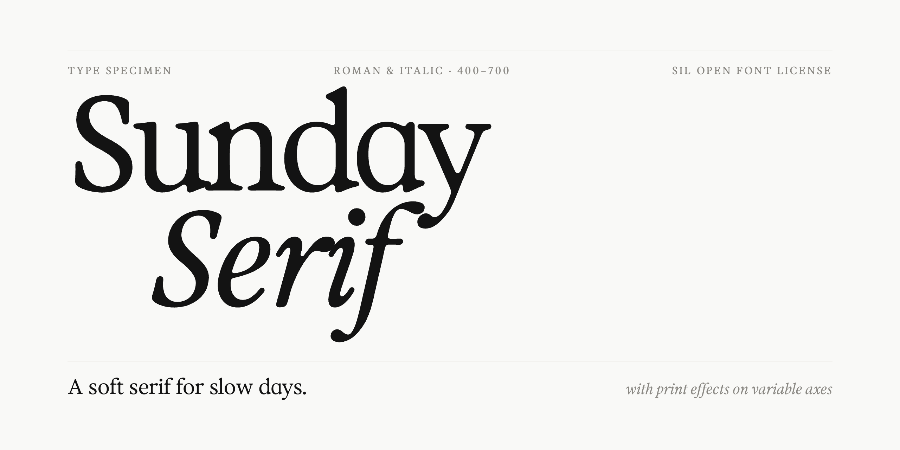
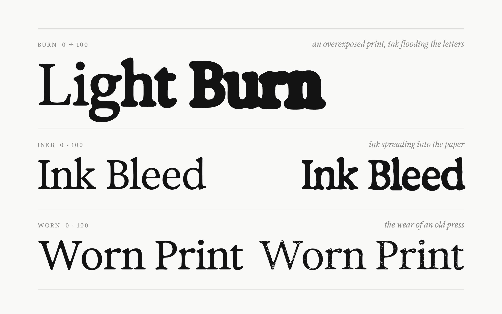
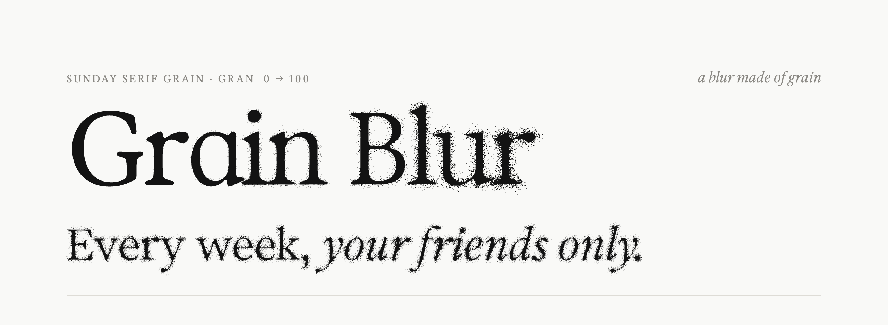
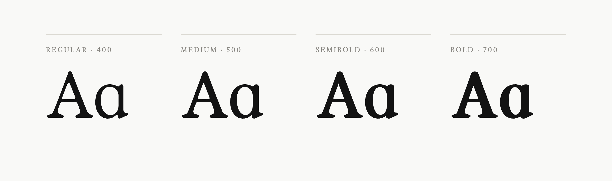
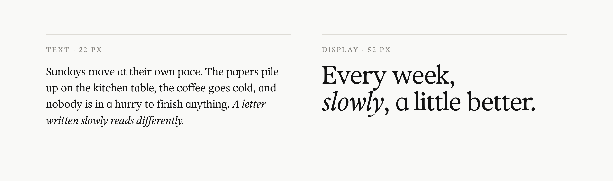
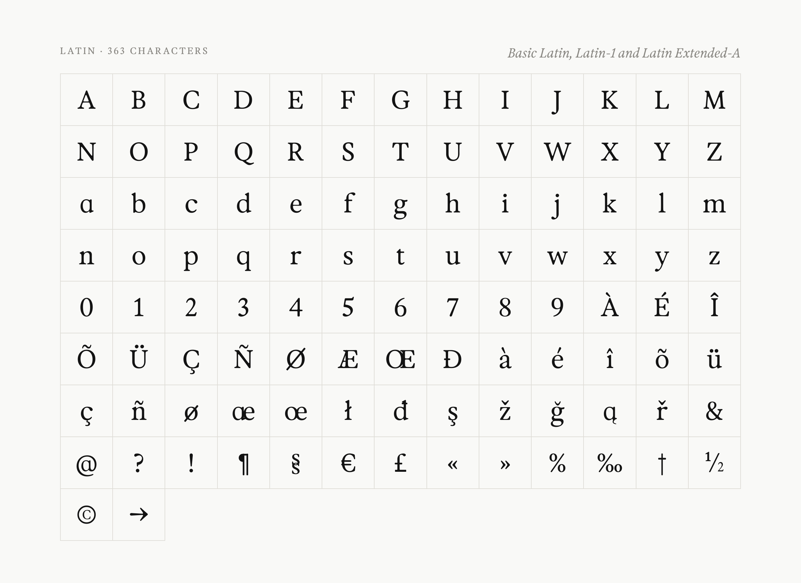

<p align="center">
  <a href="https://sunday-serif.kkratter.com/">
    <picture>
      <source media="(prefers-color-scheme: dark)" srcset=".github/readme/banner-dark.png">
      
    </picture>
  </a>
</p>

<p align="center">
  <a href="https://github.com/kkratterf/sunday-serif/releases/latest"><b>Download</b></a>
  &nbsp;·&nbsp;
  <a href="https://sunday-serif.kkratter.com/">Website</a>
  &nbsp;·&nbsp;
  <a href="https://www.npmjs.com/package/sunday-serif">npm</a>
  &nbsp;·&nbsp;
  <a href="#license">OFL 1.1</a>
</p>

**A soft serif for slow days.** Free and open-source, with print effects on variable axes.

A text face in roman and italic, from Regular to Bold. Three further axes borrow from the print shop: exposure, ink and wear. Set them once for a look, or move them with a line of CSS.

```bash
pnpm add sunday-serif
```

## Effects

<picture>
  <source media="(prefers-color-scheme: dark)" srcset=".github/readme/effects-dark.png">
  
</picture>

| Axis | Tag | Range | |
| --- | --- | --- | --- |
| Light Burn | `BURN` | 0 to 100, default 0 | Overexposure. The ink spreads until the counters fill in. |
| Ink Bleed | `INKB` | 0 to 100, default 0 | Ink spreading into the paper. Puffy, organic letters; spacing never changes. |
| Worn Print | `WORN` | 0 to 100, default 0 | The wear of an old press. Grain eating the edges, dust and starved patches where the ink did not reach; spacing never changes. |

The axes combine with one another and with weight, in both styles.

## Grain Blur

<picture>
  <source media="(prefers-color-scheme: dark)" srcset=".github/readme/grain-dark.png">
  
</picture>

**Sunday Serif Grain** is a separate display cut with one axis: a blur made of grain, like a dithered photo. At 0 the letters are plain; towards 100 a cloud of ink dots spreads out from every edge. Spacing never changes. Regular and italic.

| Axis | Tag | Range | |
| --- | --- | --- | --- |
| Grain Blur | `GRAN` | 0 to 100, default 0 | A halo of ink grain around the letters, dense at the edge and sparse further out. |

## Weights

<picture>
  <source media="(prefers-color-scheme: dark)" srcset=".github/readme/weights-dark.png">
  
</picture>

A continuous `wght` axis from 400 to 700, with named instances at Regular, Medium, SemiBold and Bold.

## In use

<picture>
  <source media="(prefers-color-scheme: dark)" srcset=".github/readme/text-dark.png">
  
</picture>

## Character set

<picture>
  <source media="(prefers-color-scheme: dark)" srcset=".github/readme/glyphs-dark.png">
  
</picture>

Basic Latin, Latin-1 Supplement and Latin Extended-A. OpenType: kerning, `case`, `ordn` and `ccmp`.

## Files

Each release ships `SundaySerif-X.Y.Z.zip`:

| Folder | Contents | For |
| --- | --- | --- |
| `variable/` | `SundaySerif[BURN,INKB,WORN,wght].ttf`, `SundaySerif-Italic[…].ttf`; `SundaySerifGrain[GRAN].ttf`, `SundaySerifGrain-Italic[GRAN].ttf` | Design apps, the desktop |
| `otf/`, `ttf/` | Regular, Medium, SemiBold, Bold and italics, effects at 0 | Apps without variable fonts, mobile |
| `webfonts/` | `SundaySerifText-*` (weight only, ~55 KB), `SundaySerif-*` (all axes, ~1.8 MB) and `SundaySerifGrain-*` (Grain Blur, ~1.5 MB), WOFF2 | The web |

## Web

The [npm package](npm/README.md) carries the files, the CSS and a ready `next/font` setup. To host the files yourself, use two cuts per style:

| File | Axes | Size | |
| --- | --- | --- | --- |
| `SundaySerifText-Variable.woff2`, `SundaySerifText-Italic-Variable.woff2` | `wght` | ~55 KB | Running text. Preload it. |
| `SundaySerif-Variable.woff2`, `SundaySerif-Italic-Variable.woff2` | `wght`, `BURN`, `INKB`, `WORN` | ~1.8 MB | Only where an effect shows. |
| `SundaySerifGrain-Variable.woff2`, `SundaySerifGrain-Italic-Variable.woff2` | `GRAN` | ~1.5 MB | Sunday Serif Grain, for display lines. |

Nearly all of a variable font's weight is the variation data of its axes; the text cut leaves the effects out and is about ten times lighter. Declared under its own family name, the full cut is downloaded only by pages that use it.

Weight is set with `font-weight`. The effects go through `font-variation-settings`, with their tags quoted and in capitals.

```css
@font-face {
  font-family: "Sunday Serif";
  src: url("fonts/SundaySerifText-Variable.woff2") format("woff2");
  font-weight: 400 700;
  font-style: normal;
  font-display: swap;
}
@font-face {
  font-family: "Sunday Serif";
  src: url("fonts/SundaySerifText-Italic-Variable.woff2") format("woff2");
  font-weight: 400 700;
  font-style: italic;
  font-display: swap;
}
@font-face {
  font-family: "Sunday Serif FX";
  src: url("fonts/SundaySerif-Variable.woff2") format("woff2");
  font-weight: 400 700;
  font-style: normal;
  font-display: swap;
}

body {
  font-family: "Sunday Serif", Georgia, serif;
}
h1 {
  font-weight: 600;
}
.with-effects {
  font-family: "Sunday Serif FX", "Sunday Serif", Georgia, serif;
}
```

```html
<link rel="preload" href="/fonts/SundaySerifText-Variable.woff2" as="font" type="font/woff2" crossorigin>
```

### Next.js

`next/font/local` serves the files under hashed, cacheable names, preloads them and derives a metric-matched fallback, so the layout holds while the font loads. It does not subset local fonts, hence the text cut.

```ts
import localFont from "next/font/local";

export const sundaySerif = localFont({
  src: [
    { path: "./fonts/SundaySerifText-Variable.woff2", weight: "400 700", style: "normal" },
    { path: "./fonts/SundaySerifText-Italic-Variable.woff2", weight: "400 700", style: "italic" },
  ],
  variable: "--font-sunday-serif",
  display: "swap",
  fallback: ["Georgia", "serif"],
  adjustFontFallback: "Times New Roman",
});

// Only where effects show: not preloaded, so it costs nothing on pages that do not use it.
export const sundaySerifFx = localFont({
  src: [
    { path: "./fonts/SundaySerif-Variable.woff2", weight: "400 700", style: "normal" },
    { path: "./fonts/SundaySerif-Italic-Variable.woff2", weight: "400 700", style: "italic" },
  ],
  variable: "--font-sunday-serif-fx",
  display: "swap",
  preload: false,
});
```

Add `${sundaySerif.variable} ${sundaySerifFx.variable}` to `<html>`, then use `var(--font-sunday-serif)` and `var(--font-sunday-serif-fx)`. Static export works too.

### Effects in CSS

`font-variation-settings` replaces the whole list each time it is set. Keep each effect in a custom property and always write the three together:

```css
:root {
  --burn: 0;
  --ink: 0;
  --worn: 0;
}
.with-effects {
  font-variation-settings: "BURN" var(--burn), "INKB" var(--ink), "WORN" var(--worn);
  transition: font-variation-settings 0.6s ease;
}
.headline {
  --ink: 40;
  --worn: 20;
}
.headline:hover {
  --burn: 80;
}
```

From JavaScript: `element.style.setProperty("--burn", "60")`.

Sunday Serif Grain has its own family and a single axis:

```css
@font-face {
  font-family: "Sunday Serif Grain";
  src: url("fonts/SundaySerifGrain-Variable.woff2") format("woff2");
  font-display: swap;
}
.grainy {
  font-family: "Sunday Serif Grain", "Sunday Serif", serif;
  font-variation-settings: "GRAN" 80;
}
```

## Desktop and Figma

Install `variable/` where variable fonts are supported: the axes appear as sliders (in Figma, under "Variable font axes"). Elsewhere install `otf/`. One or the other, not both. In Figma everyone editing a file needs the font installed, unless it is uploaded as a shared font (Organization and Enterprise plans).

## Mobile

React Native cannot set custom axes, so apps use the static files in `ttf/`. With Expo, embed them through the `expo-font` config plugin and refer to each style by its PostScript name, `SundaySerif-Medium` for instance, the same on iOS and Android.

## Build

Built from the UFO sources with [fontmake](https://github.com/googlefonts/fontmake), checked with [fontbakery](https://github.com/fonttools/fontbakery). Requires [uv](https://docs.astral.sh/uv/), which also provides Python 3.12.

```bash
make            # everything, into fonts/
make variable   # the two variable fonts only
make test       # fontbakery, reports in build/fontbakery/
```

The version comes from [`VERSION`](VERSION).

## Repository

| Path | What it is |
| --- | --- |
| `sources/SundaySerif.designspace`, `sources/SundaySerif-Italic.designspace` | The two designspaces, with the axes and the masters |
| `sources/Roman/`, `sources/Italic/` | The UFO masters, Regular and Bold: 11 Light Burn masters each, plus the Ink Bleed and Worn Print masters. Bold is derived from Regular by `scripts/derive_weight.py`; Medium and SemiBold are interpolated. They open in [Fontra](https://fontra.xyz), Glyphs, RoboFont or FontLab |
| `sources/SundaySerifGrain*.designspace`, `sources/Grain/`, `scripts/grain_blur.py` | Sunday Serif Grain: two masters per style (Grain Blur 0 and 100), generated from the Regular masters by the script |
| `scripts/build.py` | The build: variable fonts, statics, WOFF2, and post-processing (names, STAT, version) |
| `.github/readme/`, `scripts/readme_images.py` | The README specimens, light and dark, set in the built fonts and captured with headless Chrome |
| `llms.txt` | A plain-text summary of the font for AI assistants and agents |
| `npm/`, `scripts/npm_package.py` | The `sunday-serif` npm package: CSS, next/font helper and README; the script adds the webfonts and the version |
| `site/` | The website, [sunday-serif.kkratter.com](https://sunday-serif.kkratter.com) |
| `OFL.txt`, `FONTLOG.txt`, `AUTHORS.txt`, `CONTRIBUTORS.txt` | License and font history |

Built fonts are not committed: CI builds them for every pull request and every release.

## Credits

Designed by [Federico Kratter Thaler](https://kkratter.com) for [Sunday](https://joinsunday.co). The outlines start from [Source Serif 4](https://github.com/adobe-fonts/source-serif) by Frank Grießhammer for Adobe, reworked in shape, proportions, spacing and character set.

## Contributing

Problems and missing characters go in the [issues](https://github.com/kkratterf/sunday-serif/issues/new/choose). Before a pull request, read [AGENTS.md](AGENTS.md): the same rules apply to people and to AI agents.

## License

[SIL Open Font License 1.1](OFL.txt), with Reserved Font Name "Sunday Serif". Free to use, modify and redistribute, commercially too; a modified version must carry another name. Derived from [Source Serif 4](https://github.com/adobe-fonts/source-serif) by Adobe, also under the OFL.
