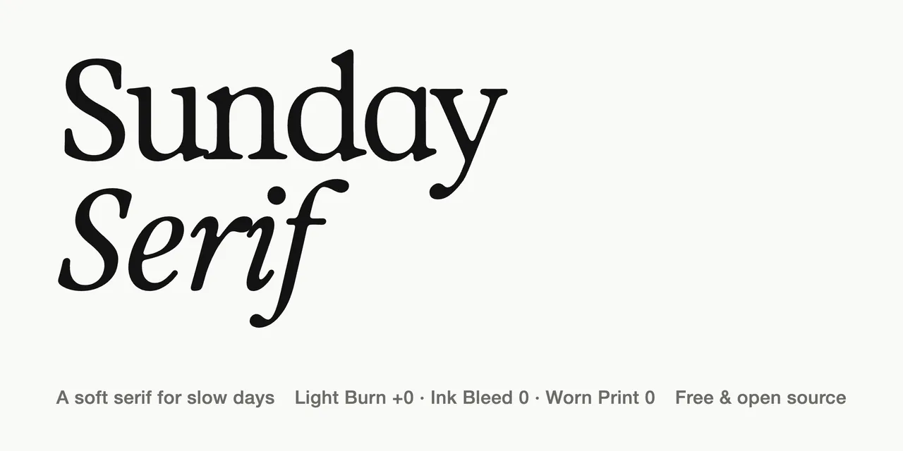
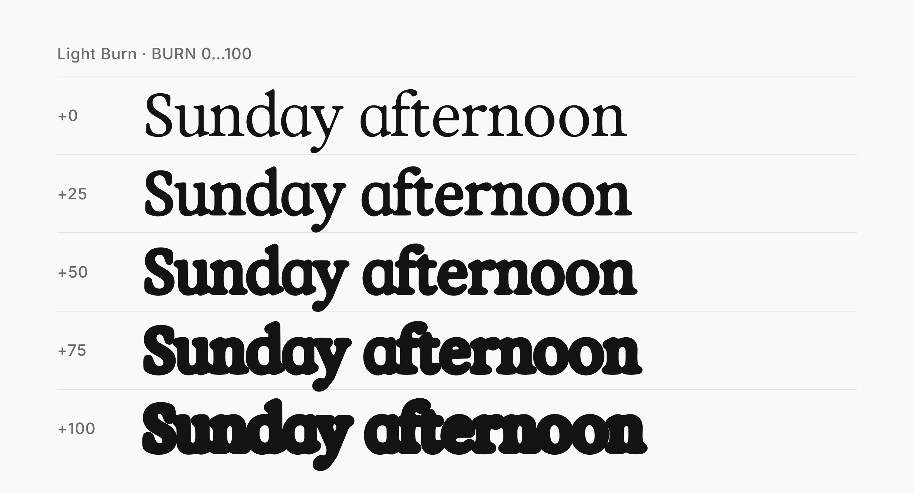
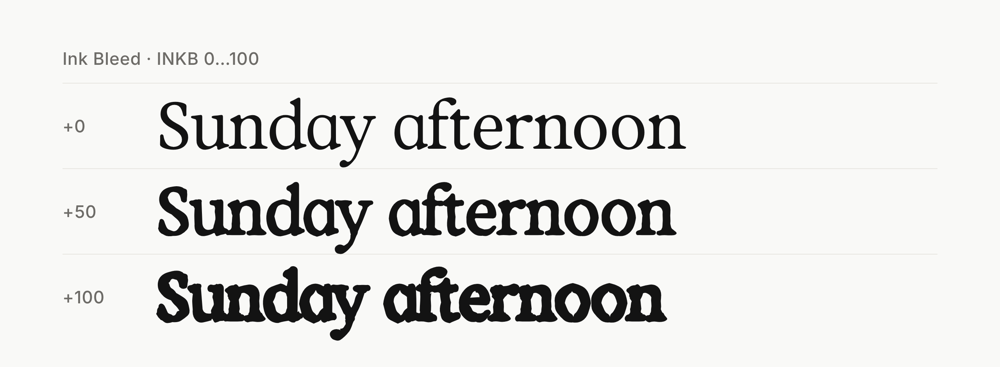
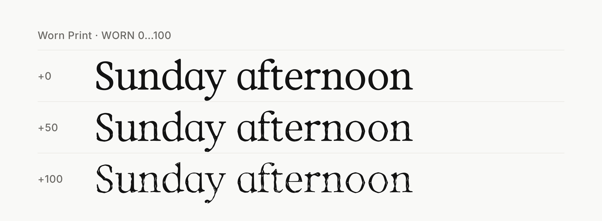
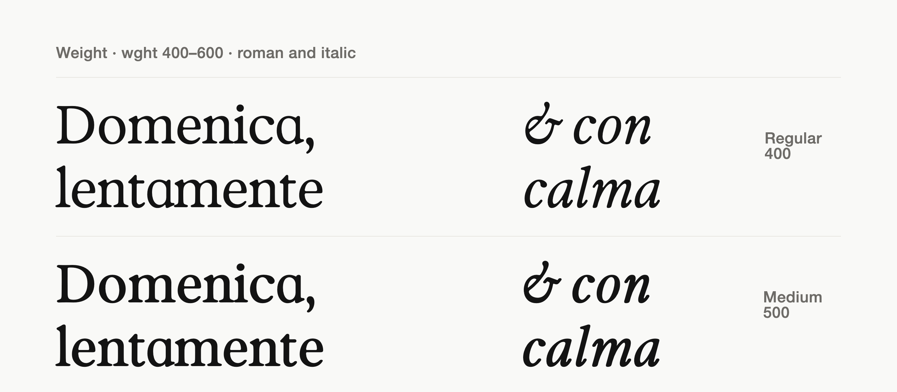
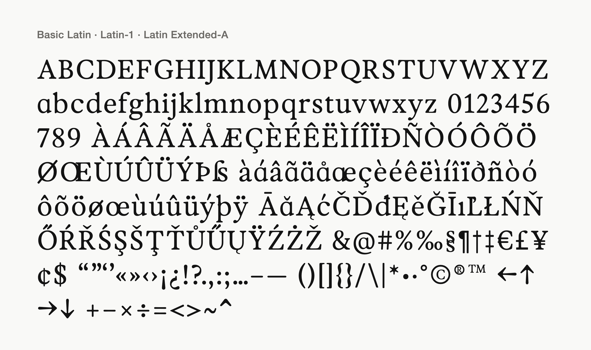

<p align="center">
  <a href="https://sunday-serif.kkratter.com/"></a>
</p>

<p align="center">
  <a href="https://github.com/kkratterf/sunday-serif/actions/workflows/ci.yml"></a>
  <a href="https://github.com/kkratterf/sunday-serif/releases/latest"></a>
  <a href="https://www.npmjs.com/package/sunday-serif"></a>
  
  <a href="#license"></a>
</p>

<p align="center">
  <a href="https://github.com/kkratterf/sunday-serif/releases/latest"><b>Download the fonts</b></a>
  &nbsp;·&nbsp;
  <a href="https://sunday-serif.kkratter.com/">Website</a>
  &nbsp;·&nbsp;
  <a href="#use-it-on-the-web">Use it on the web</a>
</p>

**A soft serif for slow days.** Free and open-source, with print effects on variable axes.

Sunday Serif is a text serif in roman and italic, from Regular to SemiBold, with three effects you can dial in like a print run: **Light Burn** floods the letters with ink like an overexposed print, **Ink Bleed** lets the ink soak into the paper, **Worn Print** wears the edges like an old letterpress. They are variable axes, so they combine, and they animate with a line of CSS.

**Install** for the web:

```bash
pnpm add sunday-serif
```

or [download the zip](https://github.com/kkratterf/sunday-serif/releases/latest) with the desktop fonts (variable TTF, static OTF and TTF) and the webfonts.

---

## The effects



#### 🔥 Light Burn · `BURN` 0 to 100

Like an overexposed photo: towards 100 the ink spreads until the letters fill in.

<table>
  <tr>
    <td width="50%" valign="top">
      
      <h4>💧 Ink Bleed · <code>INKB</code> 0 to 100</h4>
      Ink soaking into the paper: the letters get fatter and rounder, and the spacing tightens a little.
    </td>
    <td width="50%" valign="top">
      
      <h4>🖨️ Worn Print · <code>WORN</code> 0 to 100</h4>
      A worn letterpress: eroded edges and small holes inside the stems and bowls.
    </td>
  </tr>
</table>

The effects combine freely, Light Burn 100 with Ink Bleed 100 for example, at every weight and in the italic.

## Weights and italics



| Axis | Tag | Range | Default |
| --- | --- | --- | --- |
| Weight | `wght` | 400 to 600 | 400: Regular, 500: Medium, 600: SemiBold, and everything in between |
| Light Burn | `BURN` | 0 to 100 | 0 |
| Ink Bleed | `INKB` | 0 to 100 | 0 |
| Worn Print | `WORN` | 0 to 100 | 0 |

## Characters



Basic Latin, Latin-1 Supplement and Latin Extended-A: the languages of Western, Central and Eastern Europe that use the Latin script. OpenType features: kerning, `case`, `ordn`, and `ccmp`.

## What is in the release

Every release has a `SundaySerif-X.Y.Z.zip` with:

| Folder | What | Use it for |
| --- | --- | --- |
| `variable/` | `SundaySerif[BURN,INKB,WORN,wght].ttf` and `SundaySerif-Italic[...].ttf` | Apps that support variable fonts (Figma, Adobe apps, macOS, browsers). All weights and effects in two files. |
| `ttf/`, `otf/` | Regular, Medium, SemiBold and their italics | Apps without variable font support. Effects are at their default. |
| `webfonts/` | WOFF2 at 1000 UPM: `SundaySerifText-*` (weight only, ~45 KB) and `SundaySerif-*` (all axes, ~1 MB) | The web. See below which one to load. |

## Use it on the web

The webfonts are also on npm, with the CSS and a ready-made `next/font` setup:
`pnpm add sunday-serif`, then `import "sunday-serif/text.css"` or, in Next.js,
`import { SundaySerif, SundaySerifFX } from "sunday-serif/next"`. See the
[package README](npm/README.md). To host the files yourself, read on.

There are two web cuts of each style:

| File | Axes | Size | Use it for |
| --- | --- | --- | --- |
| `SundaySerifText-Variable.woff2`, `SundaySerifText-Italic-Variable.woff2` | `wght` only, effects fixed at 0 | ~45 KB | All text. Preload it. |
| `SundaySerif-Variable.woff2`, `SundaySerif-Italic-Variable.woff2` | `wght`, `BURN`, `INKB`, `WORN` | ~500 KB | Only the elements that show an effect. |

Most of a variable font's weight is the variation data of its axes, and Light Burn alone has 11
masters: dropping the effects makes the text cut about 10 times lighter. Give the two cuts different
family names in CSS: the browser downloads a font file only when some text on the page uses it,
so the full cut loads only on pages that show an effect.

The weight works with the normal `font-weight`; the effects go through `font-variation-settings`
with their four-letter tags (upper case, quoted).

```css
@font-face {
  font-family: "Sunday Serif";
  src: url("fonts/SundaySerifText-Variable.woff2") format("woff2");
  font-weight: 400 600;
  font-style: normal;
  font-display: swap;
}
@font-face {
  font-family: "Sunday Serif";
  src: url("fonts/SundaySerifText-Italic-Variable.woff2") format("woff2");
  font-weight: 400 600;
  font-style: italic;
  font-display: swap;
}
@font-face {
  font-family: "Sunday Serif FX";
  src: url("fonts/SundaySerif-Variable.woff2") format("woff2");
  font-weight: 400 600;
  font-style: normal;
  font-display: swap;
}

body {
  font-family: "Sunday Serif", Georgia, serif;
}
h1 {
  font-weight: 600;
}
.with-effects {
  font-family: "Sunday Serif FX", "Sunday Serif", Georgia, serif;
}
```

```html
<link rel="preload" href="/fonts/SundaySerifText-Variable.woff2" as="font" type="font/woff2" crossorigin>
```

### Next.js

`next/font/local` self-hosts the files with hashed, cacheable names, preloads them and builds a
size-matched fallback font so the layout does not jump when the font arrives. It does not subset
local fonts, which is why the text cut exists.

```ts
import localFont from "next/font/local";

export const sundaySerif = localFont({
  src: [
    { path: "./fonts/SundaySerifText-Variable.woff2", weight: "400 600", style: "normal" },
    { path: "./fonts/SundaySerifText-Italic-Variable.woff2", weight: "400 600", style: "italic" },
  ],
  variable: "--font-sunday-serif",
  display: "swap",
  fallback: ["Georgia", "serif"],
  adjustFontFallback: "Times New Roman",
});

// Only where effects show: not preloaded, so it costs nothing on pages that do not use it.
export const sundaySerifFx = localFont({
  src: [
    { path: "./fonts/SundaySerif-Variable.woff2", weight: "400 600", style: "normal" },
    { path: "./fonts/SundaySerif-Italic-Variable.woff2", weight: "400 600", style: "italic" },
  ],
  variable: "--font-sunday-serif-fx",
  display: "swap",
  preload: false,
});
```

Put `${sundaySerif.variable} ${sundaySerifFx.variable}` on `<html>` and use
`font-family: var(--font-sunday-serif)` and `var(--font-sunday-serif-fx)` in CSS. It works with
`output: "export"` as well.

### Effects in CSS

`font-variation-settings` replaces the whole list every time it is set, so a rule that sets only
`"INKB"` resets `"BURN"` and `"WORN"` to their defaults. Keep each effect in a custom property and
write all three together:

```css
:root {
  --burn: 0;
  --ink: 0;
  --worn: 0;
}
.with-effects {
  font-variation-settings: "BURN" var(--burn), "INKB" var(--ink), "WORN" var(--worn);
  transition: font-variation-settings 0.6s ease;
}
.headline {
  --ink: 40;
  --worn: 20;
}
.headline:hover {
  --burn: 80;
}
```

From JavaScript, change the same properties:

```js
element.style.setProperty("--burn", "60");
```

## Use it on the desktop and in Figma

Install the files from `variable/` if your app supports variable fonts: the weight and effect
sliders appear in its typography panel (Figma: "Variable font axes"; InDesign and Illustrator:
the variable font button next to the style menu). Otherwise install `otf/`. Only install one of
the two, or the app may show duplicate styles.

Figma uses the fonts installed on your computer (in the browser through the Figma font installer).
Everyone who edits a file needs them installed, unless the team uploads them as shared fonts
(Organization and Enterprise plans).

## Use it in a mobile app

React Native has no style for custom variable axes, so apps use the static TTF files from `ttf/`
(Regular, Medium, SemiBold and italics, effects at 0). With Expo, embed them at build time with the
`expo-font` config plugin and refer to each style by its file name (for example
`fontFamily: "SundaySerif-Medium"`), which is also its PostScript name, so the same name works on
iOS and Android.

## Build

The fonts are built from the UFO sources with [fontmake](https://github.com/googlefonts/fontmake)
and checked with [fontbakery](https://github.com/fonttools/fontbakery). You need
[uv](https://docs.astral.sh/uv/) (`brew install uv`); it also fetches Python 3.12.

```bash
make          # builds everything into fonts/
make variable # only the two variable fonts, faster
make test     # fontbakery, reports in build/fontbakery/
```

The version of the build comes from the [`VERSION`](VERSION) file.

## Repository

| Path | What it is |
| --- | --- |
| `sources/SundaySerif.designspace`, `sources/SundaySerif-Italic.designspace` | The two designspaces, with the axes and the masters |
| `sources/Roman/`, `sources/Italic/` | The UFO masters: for each weight, 11 Light Burn masters plus the Ink Bleed and Worn Print masters. They open in [Fontra](https://fontra.xyz), Glyphs, RoboFont or FontLab |
| `scripts/build.py` | The build: variable fonts, statics, WOFF2, and post-processing (names, STAT, version) |
| `.github/readme/`, `scripts/readme_images.py` | The README images, rendered from the built fonts with headless Chrome |
| `llms.txt` | A plain-text summary of the font for AI assistants and agents |
| `npm/`, `scripts/npm_package.py` | The `sunday-serif` npm package: CSS, next/font helper and README; the script adds the webfonts and the version |
| `site/` | The website, [sunday-serif.kkratter.com](https://sunday-serif.kkratter.com) |
| `OFL.txt`, `FONTLOG.txt`, `AUTHORS.txt`, `CONTRIBUTORS.txt` | License and font history |

Built fonts are not committed: CI builds them on every pull request and attaches them to each
GitHub Release.

## Credits

Made by [Federico Kratter Thaler](https://kkratter.com) for [Sunday](https://joinsunday.co): every week, your friends only. The outlines start from [Source Serif 4](https://github.com/adobe-fonts/source-serif) by Frank Grießhammer for Adobe, reworked in shape, proportions, spacing and character set.

## Contributing

Report a problem or ask for a character with an [issue](https://github.com/kkratterf/sunday-serif/issues/new/choose).
Pull requests are welcome: read [AGENTS.md](AGENTS.md) first, it holds the rules for humans and
AI agents alike.

## License

Sunday Serif is licensed under the [SIL Open Font License 1.1](OFL.txt), with Reserved Font Name
"Sunday Serif": you can use, modify and redistribute it freely, also commercially, but a modified
version must be published under another name. Its outlines are derived from
[Source Serif 4](https://github.com/adobe-fonts/source-serif) by Adobe, also under the OFL.
