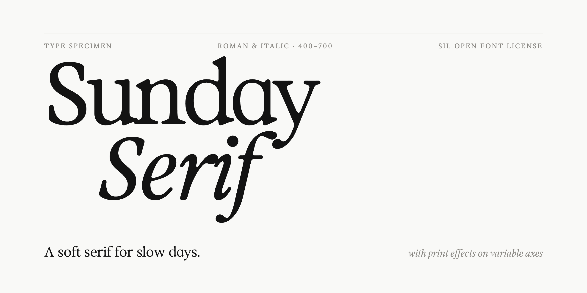
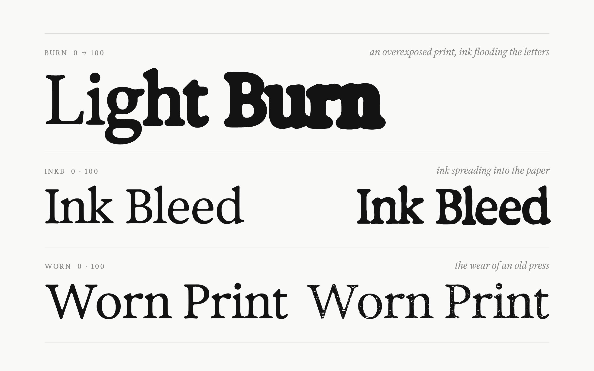
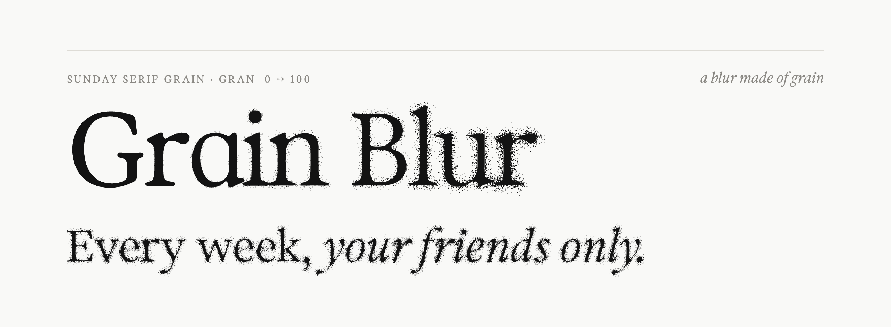

<p align="center">
  <a href="https://sunday-serif.kkratter.com/"></a>
</p>

<p align="center">
  <a href="https://sunday-serif.kkratter.com/">Website</a>
  &nbsp;·&nbsp;
  <a href="https://github.com/kkratterf/sunday-serif">GitHub</a>
  &nbsp;·&nbsp;
  <a href="https://github.com/kkratterf/sunday-serif/releases/latest">Desktop fonts</a>
  &nbsp;·&nbsp;
  <a href="#license">OFL 1.1</a>
</p>

**A soft serif for slow days.** Free and open-source, with print effects on variable axes.

The webfonts of Sunday Serif, with ready `@font-face` rules and `next/font` objects. A text face in roman and italic, from Regular to Bold, with three axes borrowed from the print shop: exposure, ink and wear.

```bash
pnpm add sunday-serif
```

## Effects



| Axis | Tag | Range | |
| --- | --- | --- | --- |
| Weight | `wght` | 400 to 700, default 400 | Regular, Medium, SemiBold, Bold and everything between. |
| Light Burn | `BURN` | 0 to 100, default 0 | Overexposure. The ink spreads until the counters fill in. |
| Ink Bleed | `INKB` | 0 to 100, default 0 | Ink spreading into the paper. Rounder forms, slightly tighter spacing. |
| Worn Print | `WORN` | 0 to 100, default 0 | The wear of an old press: grain at the edges, dust, starved patches. |

## Grain Blur



Sunday Serif Grain is a separate display family with one axis, `GRAN` (0 to 100): a blur made of grain, like a dithered photo. Spacing never changes.

## What to import

| Import | Family | Axes | Size per style | |
| --- | --- | --- | --- | --- |
| `sunday-serif/text.css` | `Sunday Serif` | `wght` | ~55 KB | Running text |
| `sunday-serif/fx.css` | `Sunday Serif FX` | `wght` `BURN` `INKB` `WORN` | ~1.8 MB | Only where an effect shows |
| `sunday-serif/grain.css` | `Sunday Serif Grain` | `GRAN` | ~1.5 MB | Display lines |

A browser downloads a font only when some text uses its family, so the heavier cuts cost nothing on pages that do not use them.

## Next.js

```tsx
// app/layout.tsx
import { SundaySerif, SundaySerifFX } from "sunday-serif/next";

export default function RootLayout({ children }: { children: React.ReactNode }) {
  return (
    <html lang="en" className={`${SundaySerif.variable} ${SundaySerifFX.variable}`}>
      <body>{children}</body>
    </html>
  );
}
```

```css
body {
  font-family: var(--font-sunday-serif);
}
.headline {
  font-family: var(--font-sunday-serif-fx);
  font-weight: 600;
  font-variation-settings: "BURN" 40, "INKB" 30, "WORN" 0;
}
```

`SundaySerif` is preloaded. `SundaySerifFX` and `SundaySerifGrain` (`--font-sunday-serif-grain`) are not.

## Any bundler

```js
import "sunday-serif/text.css";
import "sunday-serif/fx.css";    // where effects show
import "sunday-serif/grain.css"; // for Grain Blur
```

## Effects in CSS

`font-variation-settings` replaces the whole list each time it is set. Keep each effect in a custom property and write them together:

```css
.with-effects {
  font-family: "Sunday Serif FX", "Sunday Serif", serif;
  font-variation-settings: "BURN" var(--burn, 0), "INKB" var(--ink, 0), "WORN" var(--worn, 0);
  transition: font-variation-settings 0.6s ease;
}
.grainy {
  font-family: "Sunday Serif Grain", "Sunday Serif", serif;
  font-variation-settings: "GRAN" 80;
}
```

## License

[SIL Open Font License 1.1](OFL.txt), with Reserved Font Name "Sunday Serif". Designed by [Federico Kratter Thaler](https://kkratter.com) for [Sunday](https://joinsunday.co).
